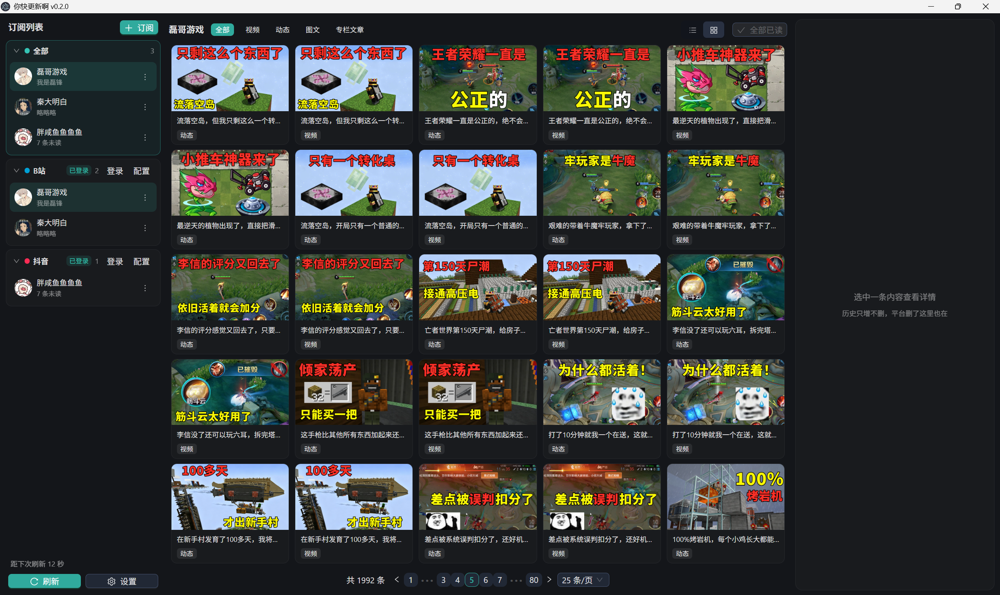
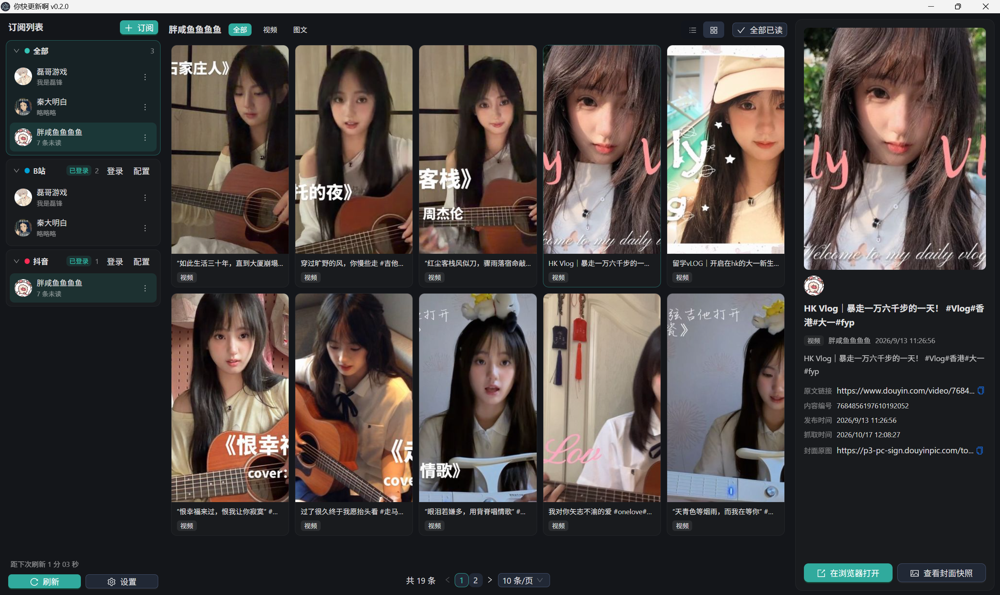

# up-watcher（你快更新啊）

订阅 B站 / 抖音的 UP 主与博主，定时检查更新并弹通知。

因为B站上看到的gemini的形象很可爱，所以图标使用了哈吉米的二创。





## 功能

- 定时检查订阅更新，浮窗/Windows通知提醒，支持开机启动。
- 登录后可从关注列表搜索、多选、批量订阅
- 数据全部存在 exe 同级的 `up-watcher-data/`，绿色便携

## 运行

```powershell
npm install   # 需要 Node 22
npm start     # 构建界面并启动
npm run dist  # 打包 exe
```

配置直接改 `up-watcher-data/_global/platforms.json`（支持注释，字段说明见同目录的 配置说明.txt）。

以上。